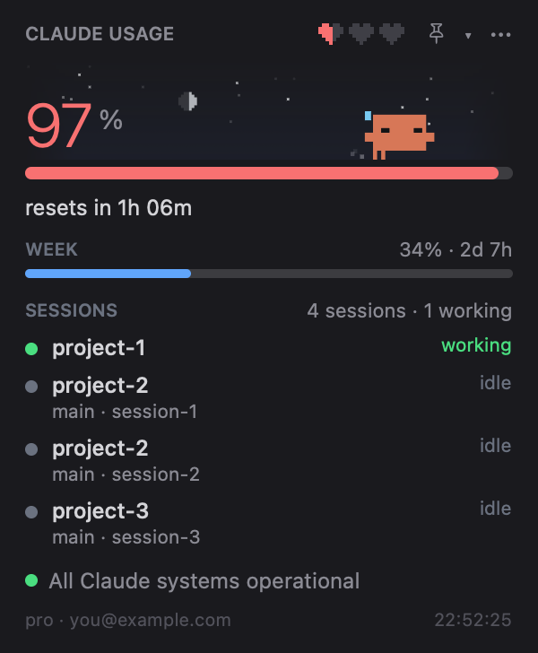
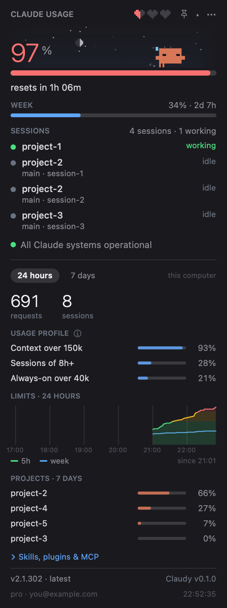
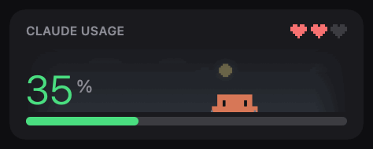

# Claudy Usage

**Your Claude Code limits, at a glance in the Mac menu bar.**

Track your 5-hour and weekly limits, see which sessions need you, and keep Clawd — a pixel crab that reacts to your activity — nearby. Built with Swift and SwiftUI, with no third-party dependencies.

<p align="center">
  
  
</p>

<p align="center">
  <a href="https://github.com/juliobianco/claudy-usage-mac/releases/latest">Download for macOS</a> ·
  <a href="#install">Install</a> ·
  <a href="docs/GUIDE.md">User guide</a> ·
  <a href="CHANGELOG.md">Changelog</a> ·
  <a href="CONTRIBUTING.md">Contribute</a>
</p>

A native macOS port of [Enhed/clawd-usage-winwidget](https://github.com/Enhed/clawd-usage-winwidget), with a floating widget, quota-cycle charts, and English and Brazilian Portuguese support.

> A fan project, unaffiliated with Anthropic. Claude and Clawd belong to Anthropic.

**Latest release: [v0.4.0](https://github.com/juliobianco/claudy-usage-mac/releases/tag/v0.4.0).** Pace forecast and alert, usage by project and model, a heatmap, chart marks, CSV export and service status in detail. See the [release notes](CHANGELOG.md#040---2026-10-19).

## Install

**Requirements:** macOS 14 or later and Claude Code installed and logged in. Liquid Glass requires macOS 26; earlier versions use a solid background. Release downloads support both Apple silicon and Intel.

### Homebrew

```sh
brew install --cask juliobianco/tap/claudy-usage
```

The [Homebrew tap](https://github.com/juliobianco/homebrew-tap) installs the release app and clears its download quarantine. The app is ad-hoc signed and **not notarized**.

### Download the app

1. Download `ClaudyUsage-<version>-macos.zip` from the [latest release](https://github.com/juliobianco/claudy-usage-mac/releases/latest).
2. Unzip it and move `ClaudyUsage.app` to `/Applications`.
3. Open the app. If macOS blocks it, go to **System Settings → Privacy & Security → Open Anyway** after the first attempt.

You can also clear the quarantine in Terminal:

```sh
xattr -dr com.apple.quarantine /Applications/ClaudyUsage.app
```

Each release includes a `.sha256` file. Compare it with `shasum -a 256 ClaudyUsage-<version>-macos.zip` to verify your download.

### Build from source

Requires Xcode or its command line tools with Swift 6.

```sh
git clone https://github.com/juliobianco/claudy-usage-mac.git
cd claudy-usage-mac
./scripts/bundle.sh
open ~/Applications/ClaudyUsage.app
```

The script builds outside `~/Documents` to avoid macOS file attributes that interfere with signing, then installs the app in `~/Applications`.

## Get started

Click the **menu bar icon** to open the panel; the app has no Dock icon.

- Check the **5-hour and weekly bars** for usage and reset times. Numbers refresh every minute, or every 20 seconds once either limit reaches 90%.
- Open **▾ details** for 24-hour stats, the weekly quota-cycle chart and project breakdowns. History builds up from your first launch.
- Click the **pin** to put a floating widget on your desktop. Fold it into a bubble for a smaller view.
- Open **⋯ → Settings…** to choose a theme, language, skin and label style. Enable **Launch at login** under **System**.

Location is optional and only used for the weather behind Clawd. You can decline access or set a fixed place in Settings.

## Features

| Feature | What you get |
|---|---|
| **Plan limits** | 5-hour and weekly usage with reset countdowns, plus the separate Fable limit when your plan reports one. |
| **Live sessions** | Running Claude Code sessions with project, branch, worktree and working / waiting / idle state. |
| **Pace** | "At this pace: 100% at 16:07" under the 5-hour bar, and "at the week's average" under the weekly one. A notification when you will hit the 5-hour limit within the hour (on by default, one switch to turn it off). |
| **Alerts** | A blinking **?** when a session needs you and confetti when a limit resets. Notifications for a waiting session and for a reset are optional and off by default. |
| **Usage history** | 24-hour and weekly charts with marks for resets and for reaching 100%, project and model shares for the last 24 hours or 7 days (click a project for its models and busiest hours), an hour-by-day heatmap, and breakdowns for skills, plugins, MCP servers and subagents. Export it as CSV from the ⋯ menu. A "Token stats" window charts tokens per day by model, from Claude Code's own stats cache. |
| **Floating widget** | A movable card that folds into a two-ring bubble, with opacity and always-on-top controls. Liquid Glass on macOS 26+. |
| **Clawd and the sky** | A reactive pixel crab, 11 skins, themes, local weather, sunrise, sunset and moon phases. |
| **Claude Code settings** | Edit selected Claude Code preferences, save three presets and revert changes. The app keeps a backup. |
| **Status and updates** | Claude service status with the affected components and open incidents, a warning when the usage read keeps failing, account information and Claude Code version checks, with a manual update action. |

<p align="center">
  
  
</p>

Screenshots use redacted names or demo data; animations use scripted data. Explore the [full guide](docs/GUIDE.md) for more screenshots, settings, Clawd's moods and [custom skins](docs/CREATING-ART.md).

## Privacy and security

The app reads limits through `claude -p "/usage" --output-format text`, using your existing Claude Code login. It has no separate account and does not read your Keychain, OAuth tokens or API keys. The usage command runs without a model call or token spend.

Session and project statistics are read locally from Claude Code's files. Conversation text is not retained, and there is no analytics. Network requests cover the Claude usage probe, service status, version checks, the official changelog on GitHub and optional Open-Meteo weather using coordinates.

Changes to Claude Code's `settings.json` happen only through its Settings tab, with a `settings.json.clawd-bak` backup. The app runs `claude update` only when you click the update action.

See [data sources and refresh intervals](docs/GUIDE.md#where-the-data-comes-from) and [privacy and local storage](docs/GUIDE.md#privacy-and-security) for details.

## Updating

- **Homebrew:** run `brew update`, then `brew upgrade --cask claudy-usage`.
- **Download:** replace the app with the zip from the [latest release](https://github.com/juliobianco/claudy-usage-mac/releases/latest).
- **Source:** run `git pull`, then `./scripts/bundle.sh`.

There is no automatic self-update. See the [changelog](CHANGELOG.md) for release notes.

## Troubleshooting

| Problem | What to check |
|---|---|
| **macOS blocks the app** | Follow the [first-open instructions](#download-the-app); the download is not notarized. |
| **Usage shows `--` or “no data”** | Check `claude auth status`, then **Settings → System → Open log**. Failed probes retry after 10 seconds and keep the last known values marked *stale*. |
| **The chart looks empty** | History starts on first launch and fills as the app runs. |
| **A session is missing** | Only live processes listed in Claude Code's session files appear. |
| **There is no Fable row** | It appears only when your plan has a separate Fable limit and `/usage` reports it. |

More diagnostics and known limitations are in the [guide](docs/GUIDE.md#troubleshooting). Manual validation on other Macs, including Intel and macOS 14/15, is still on the [roadmap](ROADMAP.md).

## Development and contributing

Skins, translations, bug reports and code contributions are welcome. Start with [CONTRIBUTING.md](CONTRIBUTING.md) for build and test commands, or browse [good first issues](https://github.com/juliobianco/claudy-usage-mac/labels/good%20first%20issue).

- [User guide](docs/GUIDE.md) — detailed features, settings, animations and troubleshooting.
- [Developer reference](CLAUDE.md) — source layout, build commands and implementation notes.
- [Screenshot and GIF tools](docs/GUIDE.md#development) — generate images with demo or redacted data.
- [Creating art](docs/CREATING-ART.md) — custom skins, animations and sky sprites.
- [Roadmap](ROADMAP.md) — planned work and linked issues.
- [Port comparison](docs/PARITY.md) — feature parity with the Windows original.

## Credits and license

Based on [Enhed/clawd-usage-winwidget](https://github.com/Enhed/clawd-usage-winwidget) by [@Enhed](https://github.com/Enhed), including its porting notes, Clawd's pixel map and animations, sky and weather logic, skins and themes.

Released under the [MIT license](LICENSE), with the original copyright notice preserved. Claude and Clawd are Anthropic's; this project is not affiliated with or endorsed by Anthropic.
