# Claudy Usage guide

Detailed reference for the panel, floating widget, Clawd, settings and data sources.
For requirements and installation, see the [README](../README.md#install).

[Panel](#what-it-shows) · [Widget](#floating-widget) · [Clawd](#clawd) · [Settings](#settings) · [Skins](#skins-and-your-own-art) · [Data sources](#where-the-data-comes-from) · [Privacy](#privacy-and-security) · [Troubleshooting](#troubleshooting) · [Development](#development)

## What it shows

Click the menu bar item and a card drops down.

<p align="center">
  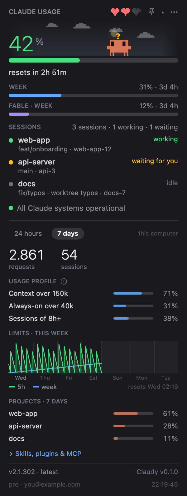
</p>

- **Menu bar label** — two mini bars, `5h` and `W`, in the colour of their level. In Settings you can switch to bars with numbers, or numbers only.
- **Big number** — the current session (the 5-hour window), straight from the server. The bar goes green → yellow → red at levels you choose (default 60% and 85%). Under it, *resets in 2h 51m*.
- **Hearts** — Clawd's health: how much of the session limit is left. Each half heart is about 16.7%.
- **WEEK** and **FABLE · WEEK** — the weekly limit and the separate weekly Fable limit, each with the time to reset. The Fable row appears only when your plan has one and `/usage` reports it.
- **SESSIONS** — every Claude Code session that is running right now, with the **project, the git branch, the worktree** and the session name, and whether it is *working*, *waiting for you* or *idle*. Handy for catching a forgotten agent burning your limit.
- **Service status** — green *All Claude systems operational*, or yellow/red with the active incident and the affected components. A click opens status.claude.com.
- **Account line** — your plan and e-mail from `claude auth status` (red *not logged in* if the login expired), and the time of the last answer, marked *stale* if it is old.
- **Claude Code version** — yellow when a newer one is out: hover for the official changelog between your version and the latest, click to run `claude update`.
- The **▾** opens the details:
  - **24 hours / 7 days** switch, with the number of requests and sessions.
  - **Usage profile** — how your usage is made up (large context, always-on context, subagent-heavy sessions, long sessions). These are independent traits, not parts of a whole: they do not add up to 100%, and the **(i)** next to the heading explains each one.
  - **Limits chart** — the 5-hour percentage (green, filled) and the weekly one (blue). On **24 hours** it shows the last day; on **7 days** it shows the **quota's own cycle**, from the last reset to the next: day 1 is the reset day, *now* is marked and the rest of the week is shaded. Hover for the time, both percentages and the busiest project of that hour.
  - **Projects · 7 days** — which projects spent the most, counted from Claude Code's transcripts (tokens weighted by the model's price; worktrees count for their repo).
  - **Skills, plugins & MCP** — the top skills, plugins, MCP servers and subagents, with readable names.
- **Alerts** — when a session is **waiting for you** the menu bar label gets a yellow **?** that blinks, the card's title becomes a pulsing *waiting for you* pill and the bubble's rim pulses; when a limit **starts over** (the 5-hour window running out, the week, or a reset Anthropic gives ahead of time) Clawd celebrates and confetti falls over the label and the bubble for a few seconds. Optional macOS notifications for each (off by default), and **Settings → Menu bar → Alerts** has buttons to preview both.
- **⋯ menu** — refresh now, settings, floating widget, launch at login, quit. The **pin** puts the widget on the screen.

## Floating widget

<p align="center">
  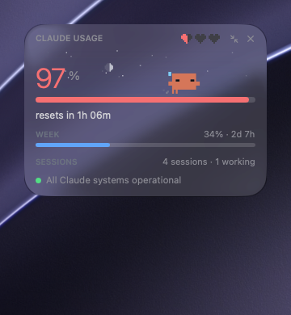
  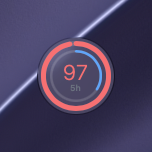
</p>

<p align="center">
  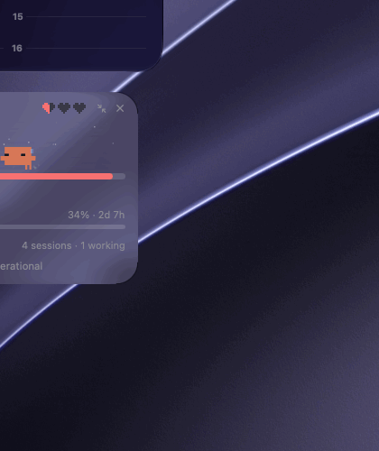
</p>

The dropdown's compact card — the sky, Clawd, the 5-hour number, the week, the sessions, the status — in its own window that floats over everything and can be put **anywhere**. Its position is remembered, and it comes back when the app starts.

- It **folds into a bubble** with two rings (5h outside, the week inside) around the 5-hour number, and unfolds again. On macOS 26 and later the card and the bubble are **Liquid Glass** and morph into each other.
- It **inflates out of the dropdown** like a bubble when you press the pin, and shrinks back into the bar when you close it.
- Options in Settings → Menu bar: show it, always on top, Liquid Glass or the theme's solid background, opacity. Right-click it for the same switches.

## Clawd

The crab from Claude Code's welcome screen, drawn from the same block glyphs and with the same animations as in the original. His mood follows your sessions and your limits:

| situation | Clawd |
|---|---|
| Claude Code is not running | burrows into the sand and sleeps, "z"s float up |
| sessions are idle | wanders, looks around, follows your cursor, whistles; sometimes waves or stretches |
| 10 minutes with no mouse over him | dozes standing up, sometimes startles |
| a session is working | runs edge to edge with a focused squint, dust flying |
| a session is waiting for you | wide eyes, jumps and waves, a yellow **?** above |
| a session just finished | crouches and throws his arms up |
| you click him | a random Claude Code animation (jump, spin, peekaboo, wink, boop, sneeze, coin hop…) and a heart |
| the 5-hour window resets | celebrates: two jumps, a green **!**, confetti |
| the session is above the red level | sweats and darts his eyes |
| the session is at 100% | lies belly-up with X eyes; click him and his soul floats out on a string |

The less limit he has left, the slower and sleepier he gets: yawns, sweat, staggering, and in the end tripping over his own legs.

Behind him is a **sky** that follows the real sunrise and sunset where you are: the sun moves along an arc, at night there is the moon **in its real phase** and twinkling stars. The weather ([Open-Meteo](https://open-meteo.com), no key) adds clouds drifting with the wind, drizzle, rain, showers, snow that settles under his feet, fog and thunderstorms. Hover the sky for the place, temperature, weather, wind, sunrise, sunset and the moon's phase.

<table>
<tr>
<td align="center">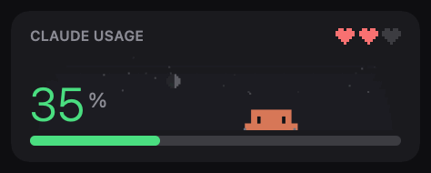<br><sub>Nothing runs: he burrows into the sand and sleeps</sub></td>
<td align="center">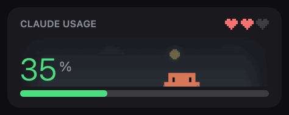<br><sub>Click him: a random Claude Code animation and a heart</sub></td>
</tr>
<tr>
<td align="center">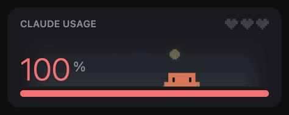<br><sub>Session at 100%: belly-up; click and his soul floats out</sub></td>
<td align="center">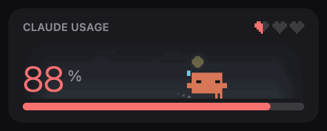<br><sub>The 5-hour window resets: celebration and confetti</sub></td>
</tr>
<tr>
<td align="center">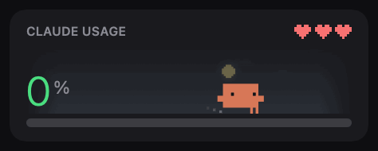<br><sub>Hearts are his health: less limit left, slower and sleepier</sub></td>
<td align="center">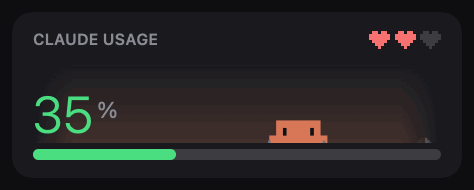<br><sub>The sky follows the time of day and the weather</sub></td>
</tr>
</table>

<p align="center">
  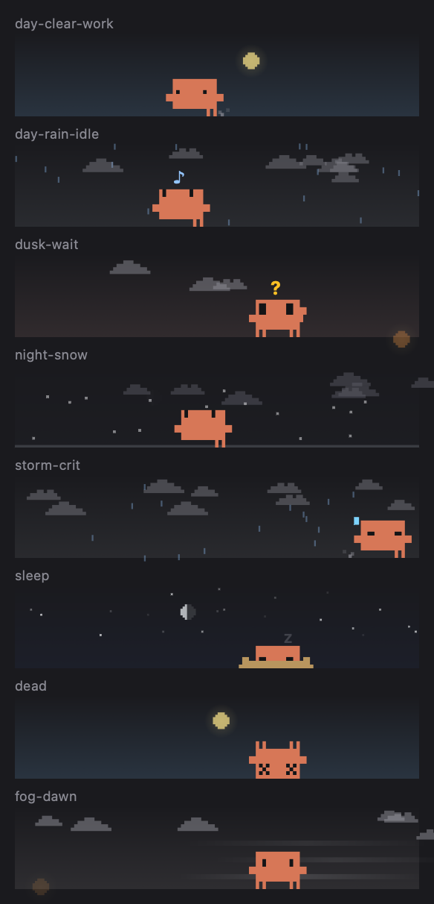
</p>

**Developer menu:** right-click the sky in the open panel to force a mood, play any move, set the hearts, the time of day or the weather. *Auto* goes back to live data. It is the quickest way to tune a skin or an animation.

## Settings

**⋯ → Settings…** opens a window with four tabs, in the language and theme you choose; everything applies at once.

<p align="center">
  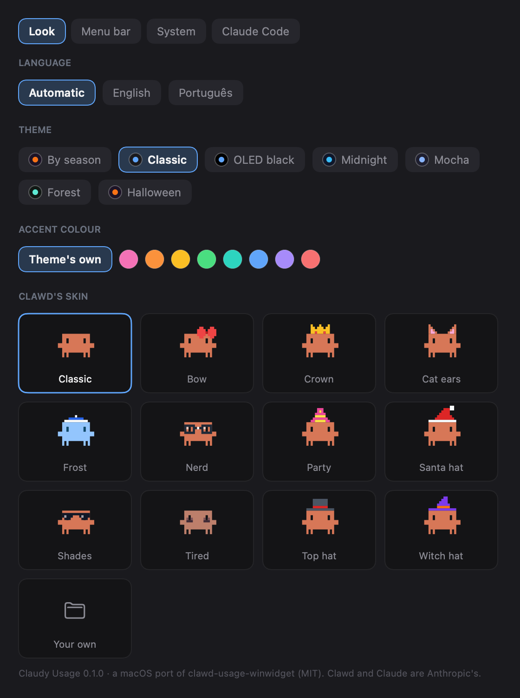
  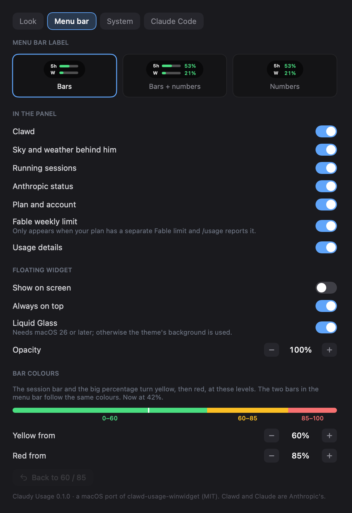
</p>

- **Look** — language (Automatic, English, **Português**), theme (*Classic, OLED black, Midnight, Mocha, Forest, Halloween*, or *By season*), an accent colour, and Clawd's **skin** as cards with a live preview (he raises his arms under the mouse).
- **Menu bar** — the label style, the **floating widget** switches, what the panel shows (Clawd, the sky and weather, sessions, status, account, the Fable row, the details), and the **bar colours**: the levels where the bars turn yellow and red, with a live scale.
- **System** — launch at login, the weather place (automatic from the system's location, or a fixed latitude and longitude), clearing the 7-day history, opening the log and the data folder.
- **Claude Code** — a picked set of **Claude Code's own settings** (`~/.claude/settings.json`), 25 of the ones that are easy to miss, each with a hint: the model of new sessions (including **Opus Plan**), fast mode, the language of answers, the permission mode at start, auto-compact, auto memory, checkpoints for `/rewind`, the byline in commits, how long sessions are kept, the update channel, the terminal theme and renderer, the answer style, the transcript view, tips, notifications to your phone and more.
  - Only the key you change is written; the rest of the file stays as it was, **in the same order**. A file that does not read as JSON is never touched.
  - The file as it was before your first change in a run is kept as `settings.json.clawd-bak`.
  - **Revert** goes back to how the keys were when Settings opened, and **three presets** remember a set of values for you to apply later.

## Skins and your own art

Clawd comes with 11 skins (a bow, a crown, cat ears, a frost body, nerd glasses, a party hat, a Santa hat, shades, tired eyes, a top hat, a witch hat). A skin is a plain text file; drop yours in `~/Library/Application Support/ClaudyUsage/skins/` and pick its card in Settings → Look:

```
---
name: Headphones
top: -2
k: #374151
g: #9CA3AF
---
....kkkkkkkkkkk...
...k...........k..
.ggk...........kgg
.gg.............gg
.gg.............gg
.gg.............gg
```

[**docs/CREATING-ART.md**](CREATING-ART.md) is the full guide: Clawd's 18×12 pixel map, the skin format, how accessories behave when he crouches or turns, previewing from the command line, writing a new animation in a few lines of Swift, and drawing new things for the sky. A different creature (another silhouette) needs a small code change; the guide says where.

## Where the data comes from

| what | source | how often |
|---|---|---|
| limits and stats | `claude -p "/usage" --output-format text` | every 60 s; every 20 s at 90% session or weekly usage; after wake |
| running sessions | `~/.claude/sessions/<pid>.json`, kept by Claude Code itself; only live processes count | every 5 s |
| project, branch, worktree | the `.git` of each session's folder, read directly | with the sessions |
| account and plan | `claude auth status` | every 10 min |
| Claude Code version | `claude --version`, and `downloads.claude.ai/claude-code-releases/latest` | hourly |
| changelog | `raw.githubusercontent.com/anthropics/claude-code/main/CHANGELOG.md` | only when an update is available |
| service status | `status.claude.com/api/v2/summary.json` | every 2 min |
| weather | `api.open-meteo.com` (latitude and longitude only) | every 10 min |
| projects and their share | Claude Code's transcripts in `~/.claude/projects` (`$CLAUDE_CONFIG_DIR` is honoured) | checked every 15 min while details are open; cached for at least 10 min |
| the limits history | each `/usage` answer, saved by the app | each answer |

`/usage` takes about two seconds, so it runs in the background and the card never freezes. If it does not answer, the app keeps the last numbers, marks them *stale* and tries again in 10 seconds.

> Never run `claude -p "/usage"` from a shell that rewrites paths (for example Git Bash): the prompt would go to the model and spend tokens. The app starts it with an argument array, never through a shell.

## Privacy and security

- **No credentials.** The app never reads your Keychain, your OAuth token or an API key, and has no login of its own. `claude` finds its own login.
- **Nothing is uploaded and there is no analytics.** The only network calls are the ones in the table above, to Anthropic's status page and download server, GitHub (the Claude Code changelog) and Open-Meteo (a latitude and longitude, no identifier).
- **Location is optional.** The system's location, with your permission, is used only to ask Open-Meteo for the weather. It is not sent anywhere else, and the original's lookup by IP address (a third party) was **left out**. You can refuse and type a fixed place instead.
- **Transcripts stay local.** Reading `~/.claude/projects` only counts tokens, timestamps and the folder of each project; the text of your conversations is not kept.
- **It changes nothing it was not asked to.** The one file of Claude Code it ever writes is `settings.json`, only when you change something in the Claude Code tab, and it keeps a backup. `claude update` runs only when you click it.
- **No self-update.** The original downloads and runs its own new versions; this port does not. Update with Homebrew, download a new release, or pull the code and rebuild; see [Updating](../README.md#updating).
- **What it stores**, all in your user folders: `~/Library/Application Support/ClaudyUsage/` (the limits history, your presets, your skins), `~/Library/Logs/ClaudyUsage.log` (probe failures; it starts over past 200 KB), the app's preferences (`defaults read dev.julio.claudy-usage`), and `settings.json.clawd-bak` next to Claude Code's settings.

## What is new compared with the original

Everything the original does on Windows is here (limits, sessions, status, version, 24h/7d stats, the 7-day chart and projects, Clawd with all his moods, the sky, skins, themes, the Claude Code settings tab), plus:

| new in this port | |
|---|---|
| **Native menu bar app** | a menu bar item with two mini bars instead of a floating window and a tray icon |
| **Floating Liquid Glass widget** | the compact card that folds into a two-ring bubble, with the bubble transition (see above) |
| **Project, branch and worktree** per session | read from git; two sessions in the same checkout are told apart by name |
| **Quota-cycle chart** | the 7-day view follows the weekly quota from reset to reset, with "now" and the rest of the week marked |
| **A cleaner details block** | one period at a time, big numbers, bars, readable names, an (i) that explains the profile |
| **Portuguese (Brasil)** | the whole interface, with English; adding a language is one table |
| **A real settings window** | with the Claude Code tab's **revert** and **three presets**, and **Opus Plan** as a model |
| **Bar colours you can set**, with a live scale | and a **label style** for the menu bar (bars, bars and numbers, numbers) |
| **Show or hide each block** | Clawd, sky, sessions, status, account, Fable, details |
| **Sky tooltip** | place, temperature, weather, wind, sun, **moon phase** |
| **Weather without an IP lookup** | the system's location (CoreLocation) or a fixed place you type |
| **Self-healing probe** | retries in 10 s, refreshes after the Mac wakes, and writes what happened to a readable log |
| **Worktree-aware projects** | a worktree counts for its repository, not as a project of its own |
| **Skin tooling** | live preview in Settings, a CLI preview, an illustrated guide ([CREATING-ART.md](CREATING-ART.md)) |
| **Developer menu** on the sky | force a mood, a move, the hearts, the time of day or the weather |
| **Tested core** | the parser, sessions, history, the project scanner, Clawd, the sky and the settings editor have unit tests |

## Not in this version

Left out on purpose or not done yet (the full comparison is in [docs/PARITY.md](PARITY.md)):

- **Chat with Clawd, reminders, lists and recurring tasks.** Planned: [docs/PHASE5.md](PHASE5.md). Reminders and lists first; chat and tasks spend plan limits, so they come with guard rails.
- **Credits and "usage by product".** The balance of the cloud session credits and the split of the week's usage by product (Claude Code, Chats, Cowork) exist only on claude.ai's usage page. `/usage` does not print them and no `claude` command exposes them.
- **The original's tips about the computer** (Windows-specific) and **Clawd's own Remote Control session** for talking from a phone.
- **Self-update** and the **lookup of your location by IP**, for the reasons in [Privacy](#privacy-and-security).
- Russian and French (the original has them); Portuguese and English are here.
- **Not yet exercised by hand:** dragging the floating widget and the click that folds the bubble, *Launch at login*, and typing a fixed place in Settings. They are built and checked as far as the screen captures show, but treat them as new.
- The download is not notarized (no Apple Developer ID): see [Install](../README.md#download-the-app).

## Troubleshooting

- **The number shows `--` or "no data"** — check that Claude Code is logged in (`claude auth status`). The panel shows why the probe failed under the number, and `~/Library/Logs/ClaudyUsage.log` has the details (**Settings → System → Open log**). A probe that times out is retried in 10 seconds; the last numbers stay on screen, marked *stale*.
- **`/usage` prints a cost summary instead of limits** — the environment is missing `USER`. Launched from Finder the environment is nearly empty; the app sets what `claude` needs. If you run `claude` yourself in a stripped environment, keep `HOME` and `USER`.
- **The Fable row is missing** — your plan has no separate Fable limit, or `/usage` does not report one.
- **The chart is nearly empty at first** — the history starts the day you first run the app, and fills in as it runs (the original could rebuild its first week from old probe transcripts; this app never left any). The week view fills up over the first week.
- **Sessions are missing** — the list comes from `~/.claude/sessions` and only counts processes that are alive.
- **Nothing happens when I build in `~/Documents`** — use `./scripts/bundle.sh`; it builds elsewhere on purpose.

## Development

```sh
S=$HOME/Library/Caches/claudy-build
swift build --scratch-path $S
swift test  --scratch-path $S           # the core's unit tests
./scripts/bundle.sh                     # builds, signs and installs ~/Applications/ClaudyUsage.app
./scripts/make-icon.sh                  # redraws Resources/AppIcon.icns from the code
```

The code is two targets: `ClaudyCore` (no UI: the `/usage` parser, sessions, history, Clawd, the mood machine, the sky, the settings editor) and `ClaudyUsage` (SwiftUI: the menu bar, the card, the settings, the floating widget). Read [CLAUDE.md](../CLAUDE.md) first: the layout, the commands, and the problems that already cost time.

Pictures without screen-recording permission, and with made-up data (nothing real on the screen):

```sh
export CLAUDY_DEMO=1 CLAUDE_CONFIG_DIR=/tmp/empty CLAUDY_VERSION="$(cat VERSION)" CLAUDY_NO_FLOAT=1
$S/debug/ClaudyUsage --readme out/        # the panel, the settings, Clawd in eight situations
$S/debug/ClaudyUsage --float-test out/    # opens the real floating window and captures it
$S/debug/ClaudyUsage --gifs out/          # the animated GIFs of Clawd (scripted, seeded)
$S/debug/ClaudyUsage --float-gif out/     # a GIF of the real floating widget inflating, folding, unfolding
$S/debug/ClaudyUsage --banner out/cover.png docs/images   # the repository's cover image (1280x640)
```

With real use instead of demo data, set `CLAUDY_REDACT=1`: projects, branches, sessions and the e-mail are replaced by stand-ins.

Other documents: [ROADMAP.md](../ROADMAP.md), [CONTRIBUTING.md](../CONTRIBUTING.md), [docs/STATUS.md](STATUS.md) (done, next, pushed back), [docs/PARITY.md](PARITY.md) (feature by feature against the original), [docs/CREATING-ART.md](CREATING-ART.md), [docs/PHASE5.md](PHASE5.md).

## Versions and news

The version is in the [`VERSION`](../VERSION) file (semantic versioning); `bundle.sh` writes it into the app, and you see it in the card's footer and in Settings. What changed in each version is in [**CHANGELOG.md**](../CHANGELOG.md). Each release is a tag (`v0.1.0`) with a GitHub Release whose notes are the changelog's entry and whose zip is the app; **Watch → Custom → Releases** on GitHub tells you when there is a new one. For each installation method, see [Updating](../README.md#updating).

